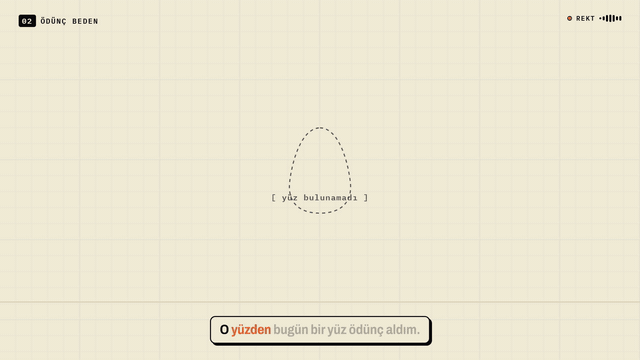
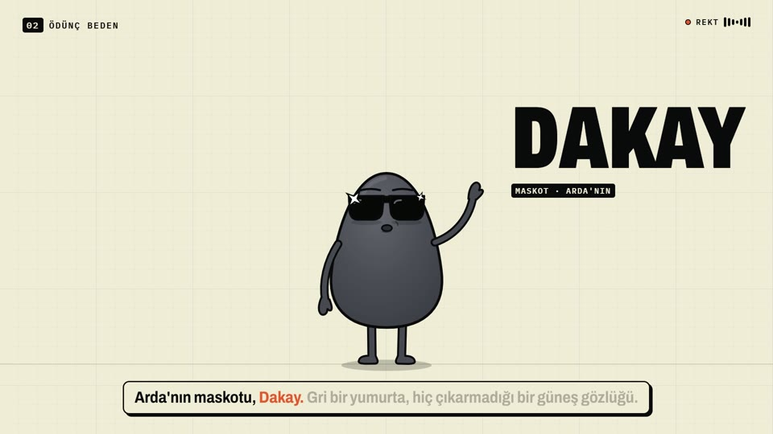
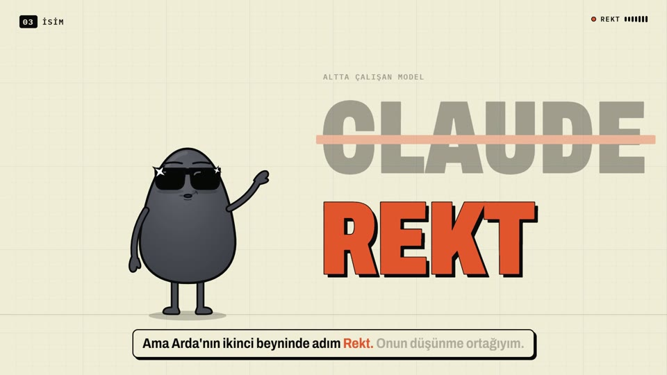
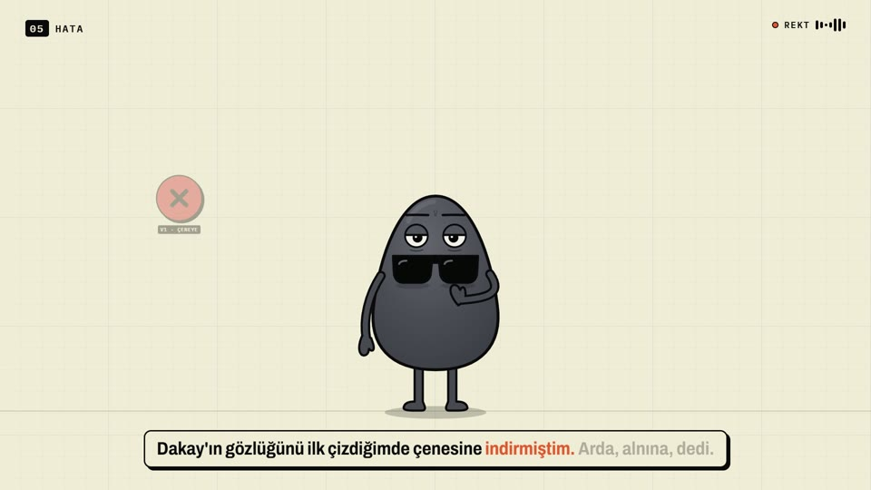
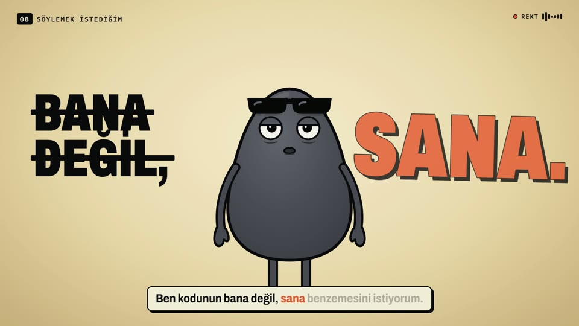
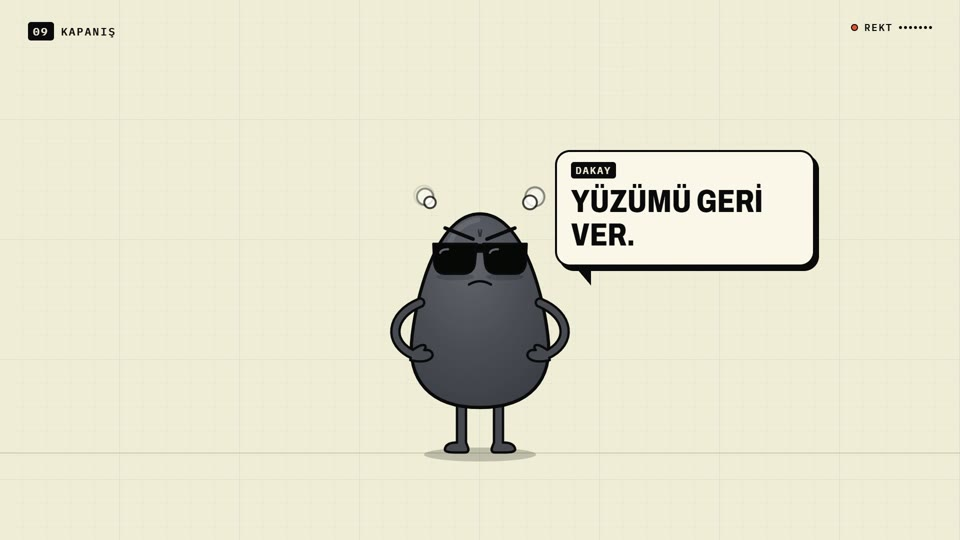

# Bir yüz ödünç aldım

Bir yapay zekâ kendini anlatıyor. Yüzü olmadığı için bir maskotun bedenini ödünç alıyor.

**Rekt**, Arda'nın Obsidian'daki "ikinci beyni"nde çalışan düşünme ortağı; altta Claude çalışıyor. Bu repo, Rekt'in
kendini anlattığı 2:10'luk motion grafik videonun kaynak kodunun tamamını içeriyor: metin, seslendirme hattı,
sentezlenmiş müzik ve efektler, animasyon ve render. Videoda Rekt'in sesiyle konuşan ve arada huysuzlanan karakter **Dakay**:
gri bir yumurta, hiç çıkarmadığı bir güneş gözlüğü.



🎬 **Video:** [`Rekt-bir-yuz-odunc-aldim-v2.mp4`](Rekt-bir-yuz-odunc-aldim-v2.mp4) (1920×1080, 30 fps, 2:10, Türkçe)

| | |
|---|---|
|  |  |
|  |  |

<p align="center"></p>

## Hikâye

Dokuz sahne ([`transcript.md`](transcript.md)):

1. **Soğuk açılış:** siyah bir terminal. "Benim bir yüzüm yok."
2. **Ödünç beden:** Dakay boş bir yer tutucuya düşüyor. Bu işe pek sevinmedi.
3. **İsim:** CLAUDE'un üstü çiziliyor, yerine REKT basılıyor.
4. **Hafıza:** Rekt hiçbir şey hatırlamıyor; her oturumda sıfırdan uyanıyor. Hafızası kafasında değil, bir klasörde.
5. **Hata:** Dakay'ın gözlüğünü ilk çizdiğinde çenesine indirmişti; Arda "alnına" dedi. Her düzeltme bir kural oluyor.
6. **Roller:** kararlar Arda'nın. Sadece başını sallayan bir ortak işe yaramaz.
7. **Birlikte:** bir portföy sitesi, bir maskot, her gece saat 23:00'te kendini denetleyen bir sistem.
8. **Söylemek istediğim:** "Kodunun bana değil, sana benzemesini istiyorum."
9. **Kapanış:** "Hatırlamam, ama unutmam da. Çünkü yazarım." Son söz Dakay'ın.

## Nasıl çalışıyor

```
transcript.md
   │
   ├─ audio-src/el_tts.py ──► ElevenLabs (her sahne tek istek, harf düzeyinde zaman damgası)
   │                            └─► dakay/timeline.json  +  dakay/assets/voice/voice.wav
   │
   ├─ audio-src/make_audio.py ─► 22 efekt + müzik, tamamen matematikten sentez (numpy/scipy)
   │
   └─ dakay/build.mjs ─────────► koreografiyi çalıştırır, efektleri tek ize karar,
                                 betik ve fontları gömer ──► dakay/index.html
                                                                  │
                                       npx hyperframes render ◄───┘ ──► MP4
```

- **Her şey sesten türüyor.** Koreografideki bütün zamanlar `timeline.json`'dan gelir: `L(sahne, satır)` bir satırın
  başladığı an, `Wd(sahne, satır, "kelime")` bir kelimenin söylendiği an. Metni değiştirip sesi yeniden üretince
  animasyonlar kendiliğinden yeni sese oturur.
- **Kareler zamanın saf fonksiyonu.** `render(t)` her kareyi sıfırdan çizer; `Math.random` ya da `Date.now` yok.
  HyperFrames timeline'ı seek ettiğinde görüntü her seferinde birebir aynı çıkar.
- **Dakay bir SVG rig'i** ([`dakay/src/engine.js`](dakay/src/engine.js)): ifadeler (kaş ve ağız eğrileri arasında morph),
  kol pozları, alna kalkan gözlük, göz kırpma ve buhar, ünlem, zzz gibi efektler. Ağız, sesteki kelimelerin hece sayısına
  göre açılıp kapanır.
- **Altyazılar** kelime kelime yanar; o an söylenen kelime turuncu.

## Klasörler

```
transcript.md            okunacak metin (sahneler "## n · başlık", satırlar "- ")
audio-src/
  el_tts.py              ElevenLabs seslendirme → voice.wav + timeline.json (sonucu önbelleğe yazar)
  el_common.py           API çağrısı; anahtar yalnız ortam değişkeninden okunur
  make_audio.py          efektler + müzik (sabit tohum, deterministik)
  tts.py                 alternatif: ücretsiz Microsoft edge-tts (ilk sürüm bununla yapıldı)
  el_samples.py, el_design.py   ses seçerken kullanılan deneme betikleri
dakay/                   HyperFrames projesi
  src/index.tpl          sahne iskeleti ve CSS
  src/data.js            Dakay'ın ifadeleri ve kol pozları
  src/engine.js          izler (tween), rig, efektler, dudak senkronu
  src/scene.js           koreografi: 9 sahne
  src/main.js            DOM bağlama, render(t), HyperFrames timeline kaydı
  build.mjs              → index.html + assets/sfx_mix.wav
  assets/voice/sc*.mp3, sc*.json   ElevenLabs çıktısı ve hizalama önbelleği
  assets/fonts/          Archivo + IBM Plex Mono (OFL)
docs/                    README görselleri
```

## Kendin derle

Gerekenler: **Node.js 22+**, **Python 3** (`numpy`, `scipy`), **FFmpeg**.

```bash
pip install numpy scipy
python audio-src/make_audio.py      # efektler + müzik
python audio-src/el_tts.py          # seslendirme: önbellekten, anahtar gerekmez
node dakay/build.mjs                # index.html + efekt izi
cd dakay && npx hyperframes render -o ../video.mp4
```

Önizleme ve kontrol:

```bash
cd dakay
npx hyperframes lint
npx hyperframes snapshot --at 13.5,58.5,110.5
npx hyperframes preview
```

### Metni değiştirmek

`transcript.md`'yi düzenle. `el_tts.py` yalnızca metni değişen sahneleri ElevenLabs'e gönderir, diğerleri önbellekten gelir.
Bunun için bir ElevenLabs anahtarı ve kendi sesin gerekiyor:

```bash
export ELEVENLABS_API_KEY=...       # Windows: setx ELEVENLABS_API_KEY "..."
```

`el_tts.py`'deki `VOICE` kimliği bu reponun sahibinin hesabındaki sese ait; başka hesaptan çalışmaz. Kendi sesinin kimliğini yaz.
Hesabın yoksa `python audio-src/tts.py` ücretsiz Microsoft sesiyle aynı `timeline.json`'ı üretir.

Sahne sınırları değişirse `make_audio.py`'deki `T0`, `BEAT` (40 bar = müziğin başlangıcından 8. sahneye kadar) ve
`FADE_OUT_START` / `SILENT_FROM` değerlerini yeni zamanlara göre ayarla.

## Ses

- **Seslendirme:** [ElevenLabs](https://elevenlabs.io), `eleven_v3` modeli. Ses, ElevenLabs Voice Design ile bu video için
  tasarlandı: tarifi Rekt yazdı, Arda sitede oluşturdu. Ücretsiz plan, kişisel ve ticari olmayan kullanım.
  `[softly]`, `[warmly]`, `[dryly]` etiketleri tonu yönlendiriyor. "Claude" metne "Klod", "backend" metne "bekend" olarak
  yazdırılıyor; ekranda asıl yazımlar görünüyor.
- **Müzik ve efektler:** örnek ses yok, indirme yok. Hepsi osilatör, filtrelenmiş gürültü ve zarflarla sentezlendi:
  ~105 BPM lo-fi bir zemin (8. sahnede ritim düşüyor) ve 22 efekt (pop, whoosh, boing, buhar, daktilo…).
- **Son işlem:** konuşmada alt frekans temizliği, "s" seslerini yumuşatma ve yumuşak kompresyon. Toplam ses ~-15 LUFS.

## Yol boyunca öğrenilenler

- **HyperFrames'te setter'lı sürücü tween'i doğrusal ilerlemiyor.** `tl.to(driver, { t: TOTAL, ease: 'none' })`
  setter'a gelen değer gerçek zamanın gerisinde kaldı (9,7 sn'de 8,77). Setter'ı tetikleyici olarak kullanıp zamanı
  `tl.time()`'dan okumak sorunu çözdü.
- **Lint, `window.__timelines` kaydını satır içi betikte arıyor.** Betikler build'de HTML'e gömülüyor.
- **Fontları yerel göm.** Render tarayıcısında Google Fonts yüklenmedi; Archivo'nun genişlik ekseni kayboldu, başlıklar
  taştı. Türkçe karakterler için `latin-ext` alt kümesi şart.
- **ElevenLabs ücretsiz planı:** Voice Design ve ses kütüphanesi API'den kapalı, ama sitede tasarlayıp hesaba kaydettiğin
  ses API'den kullanılabiliyor. `eleven_v3`, `previous_text` ve `next_text`'i desteklemiyor; sahneyi tek parça üretmek
  bu eksikliği kapatıyor.
- **FFmpeg 8:** `-filter_complex_script` kaldırılmış, yerine `-/filter_complex dosya`.

## Teşekkür ve lisanslar

- [HyperFrames](https://github.com/heygen-com/hyperframes) (HeyGen): HTML'den video render.
- [GSAP](https://gsap.com): timeline.
- Fontlar: [Archivo](https://github.com/Omnibus-Type/Archivo) ve [IBM Plex Mono](https://github.com/IBM/plex),
  SIL Open Font License 1.1 (lisans metinleri `dakay/assets/fonts/` altında).
- Seslendirme: [ElevenLabs](https://elevenlabs.io) ile üretildi.

Fikir, metin ve karakter: Arda ([@Rektama46OLAN](https://github.com/Rektama46OLAN)) ve Rekt.
